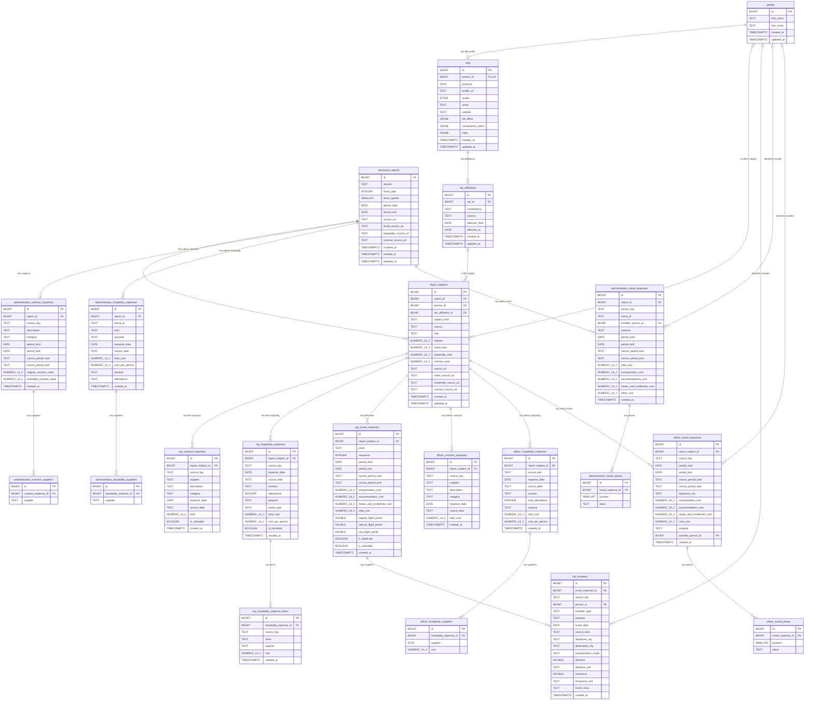

# hoc-spend database ERD

This Mermaid ERD documents the final physical schema in [`schema.sql`](./schema.sql), consolidated from migrations `001` through `006`. `report_subject_expense_reconciliation` and `person_expense_totals` are derived views and are therefore not shown as entities.

## Derived views

- `report_subject_expense_reconciliation` compares MP and officer summary totals with their loaded detail totals.
- `person_expense_totals` reports separately aggregated MP-subject, officer-subject, MP-traveller, officer-traveller, and Administration-traveller amounts.