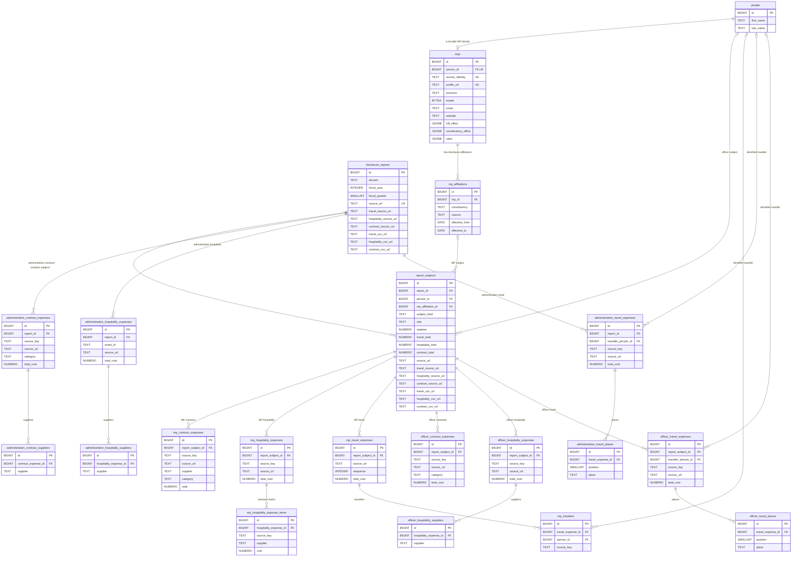

# hoc-spend database ERD

This Mermaid ERD documents the final physical schema represented by
[`../../db/001_initial_schema.sql`](../../db/001_initial_schema.sql) and
migrations `002` through `010`. It focuses on primary keys, foreign keys, and
the durable source-identity fields that matter for joins. For the complete
column-by-column reference and loading semantics, see
[`../../docs/database-schema.md`](../../docs/database-schema.md).

`report_subject_expense_reconciliation` and `person_expense_totals` are derived
views, so they are documented below rather than represented as ERD entities.

## Derived views

- `report_subject_expense_reconciliation` compares the MP and officer summary
  totals recorded on `report_subjects` to sums of their loaded contract,
  hospitality, and travel detail records.
- `person_expense_totals` exposes MP-subject, officer-subject, MP-traveller,
  officer-traveller, and Administration-traveller totals in separate columns so
  consumers do not accidentally double-count a subject's own travel.